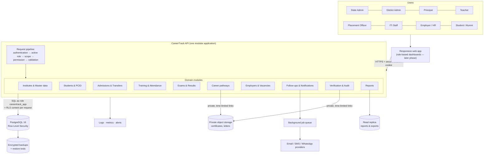
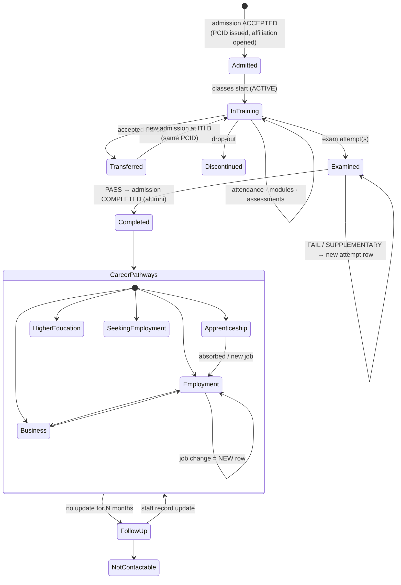

# ITI CareerTrack — Architecture & Database Design Review

**Version:** 1.0 review draft · **Date:** 31 Oct 2026 · **Status:** ⏳ Awaiting project-owner approval
**Based on:** *ITI CareerTrack – ER Diagram & System Architecture V1.0*
**Scope of this pack:** design only. No frontend and no application code have been written.

> **One Student. One Permanent Career ID. One Complete Career Journey.**

---

## How to read this pack

| File | What it is | Who it is for |
|---|---|---|
| **This document** | Every design decision explained in plain language | You (project owner) |
| [`01-ER-DIAGRAM.md`](01-ER-DIAGRAM.md) + [`diagrams/`](diagrams/) | Professional ER diagrams (domain map + 5 detailed diagrams) | You + developers |
| [`02-API-ARCHITECTURE.md`](02-API-ARCHITECTURE.md) | API rules and the full endpoint list | Developers |
| [`../database/schema.sql`](../database/schema.sql) | Complete PostgreSQL schema: 48 tables, keys, rules, security | Developers / DBA |
| [`../database/tests/acceptance_tests.sql`](../database/tests/acceptance_tests.sql) | Automated proof that the design meets the mandatory tests in section 15 | QA / reviewers |

The schema is **not just a drawing**. I loaded it into a real PostgreSQL 16 database and ran 59 automated checks against it. All 59 pass (see [Part 11](#part-11--proof-what-was-tested)).

---

## Summary: the 12 most important decisions

| # | Decision | Simple explanation |
|---|---|---|
| 1 | **Modular monolith + REST API + PostgreSQL** (as your document proposes) | One application with clean internal compartments. It is cheaper and easier to build and run than many small services, and parts can be split out later if needed. |
| 2 | **Internal ID ≠ PCID** | Every student has a hidden internal ID that the database uses to link records. The PCID is the "public" career number printed on documents. Records are linked by the internal ID, so fixing or merging a PCID never breaks any links. |
| 3 | **PCID is made only by the database** | Neither the browser nor a programmer's code can invent a PCID. A database function issues it inside the same transaction as the admission. |
| 4 | **PCID gets a check digit**: `ITIC-MH-2026-000123-7` | The last digit is calculated from the others, so if someone mistypes a PCID the system notices immediately (the same idea as a bank card number). *Needs your approval.* |
| 5 | **Duplicate prevention in 3 layers** | (a) Hard block on the same SSC seat number; (b) a fuzzy "is this the same person?" score shown before creating a student; (c) a review-and-merge process for duplicates found later. |
| 6 | **One shared database; every institute's data tagged with its ITI** | All ~1,000 ITIs share one database, but every row knows which ITI it belongs to, and the database itself filters what each user can see. |
| 7 | **Security enforced twice: in the API and inside the database** | Even if a programmer makes a mistake in one query, PostgreSQL "Row-Level Security" still hides other institutes' students. |
| 8 | **Access comes from relationships, not from menus** | A Principal sees a student because the student is (or was) enrolled at their ITI. A Teacher sees a student only while they are assigned to that student. |
| 9 | **Transfer = close one episode, open a new one** | Nothing is moved or overwritten. The old ITI's records stay intact, the new ITI gets a new admission, and the PCID never changes. |
| 10 | **History is append-only** | A new job is always a new row. Old rows cannot be "re-pointed" to a new employer; the database itself rejects that. |
| 11 | **Nothing is hard-deleted** | Mistakes are *voided* with a reason, and the application's database account has no DELETE permission at all. |
| 12 | **Every sensitive change is audited automatically** | Database triggers write who changed what, when, and the before/after values. Nobody, not even an administrator, can edit or delete the audit log through the system. |

---

## Part 1 — System architecture



**How it works, step by step (for one request):**
1. A user logs in, and the API gives the browser a secure, http-only session cookie.
2. A user can hold more than one role, for example Teacher at one ITI and Placement Officer at the same ITI. They pick **one active role** at a time, and every request runs under that one role. This is the "least privilege" principle.
3. The API checks permissions (default = deny), then opens a database transaction and tells PostgreSQL *who* is asking (`app.user_id`, `app.role_assignment_id`).
4. PostgreSQL applies Row-Level Security, so the query only ever returns rows that this person may see.
5. The response is filtered again at field level, for example salary is removed for roles without `career.salary.view`.

**Technology stack (decision needed — see Part 12):** the database design does not depend on a particular framework. My recommendation is **TypeScript (Node.js, NestJS) for the API** and React for the later frontend: one language across the whole product, strong typing, and a large hiring pool in Maharashtra. A good alternative is **Python/Django**, which has an excellent built-in admin screen for master data. Hosting should be in an **Indian cloud region**, for data residency.

**Scale check:** Maharashtra has roughly 1,000 Government and Private ITIs, with about 1.5 lakh admissions per year. That means about 1–2 million student records over a decade, and **tens of millions of attendance rows a year**. PostgreSQL handles this comfortably. Attendance is the only very large table, so it is split into yearly partitions (separate physical pieces), which keeps it fast and lets old years be archived.

---

## Part 2 — The ER diagram

See [`01-ER-DIAGRAM.md`](01-ER-DIAGRAM.md). The 48 tables fall into 7 groups:

| Group | Tables |
|---|---|
| Institutes (tenant) | districts, talukas, itis, trades, trade_modules, iti_trades, academic_years, batches |
| Identity & access | users, roles, permissions, role_permissions, user_role_assignments |
| Student identity | students, student_contacts, pcid_registry, pcid_year_counters, duplicate_candidates, student_merges |
| Enrolment | admissions, institute_affiliations, teacher_assignments, transfer_requests |
| Training & exams | training_records, attendance_records, module_progress, assessments, exam_sessions, exam_results, exam_result_components |
| Career | companies, company_branches, apprenticeships, employments, business_records, colleges, higher_education_records, career_status_history, vacancies, job_applications |
| Operations | follow_ups, verification_records, student_documents, correction_requests, consents, notifications, integration_logs, audit_logs |

---

## Part 3 — Keys, relationships and integrity rules

### 3.1 Key strategy (simple version)
- **Primary keys are UUIDs**: random 36-character IDs such as `9f1c…`. They cannot be guessed (nobody can type `/students/124` to try the next student), and they are safe to use in web addresses.
- **Very large log tables** (attendance, audit, notifications) use simple running numbers instead, because they are smaller and faster.
- **Business identifiers** (PCID, ITI code, trade code, certificate number, GSTIN) are stored as **unique** columns, never as links.

### 3.2 "Smart" foreign keys that stop impossible data
Ordinary foreign keys only check that "this ID exists". In several places I link on **two columns together**, so the database also checks that the pieces *belong together*:

| Rule | How the database enforces it |
|---|---|
| A student can only be admitted to a trade that the ITI actually offers | `admissions(iti_id, trade_id)` → `iti_trades(iti_id, trade_id)` |
| A batch must belong to the same ITI **and** trade as the admission | `admissions(batch_id, iti_id, trade_id)` → `batches` |
| A job's branch must belong to that job's company | `employments(branch_id, company_id)` → `company_branches(id, company_id)` |
| Attendance / training / results must belong to the same ITI and student as the admission | composite keys `(admission_id, iti_id)` and `(admission_id, student_id)` |
| A verification must be about a record of the **same** student | `verification_records(employment_id, student_id)` → `employments(id, student_id)` |
| An ITI's taluka must be inside the ITI's district | `itis(taluka_id, district_id)` → `talukas(id, district_id)` |

### 3.3 Business rules enforced by the database itself

| Rule from your document | Enforced by |
|---|---|
| One active PCID per student; PCID unique | `UNIQUE(pcid)` + "one ACTIVE per student" unique index |
| PCID never changes | trigger blocks any update of `pcid`, `student_id`, `issue_year`, `serial` |
| A student is never "live" at two ITIs at once | only one ACCEPTED/ACTIVE admission per student, **and** affiliation date ranges can never overlap |
| A job change never overwrites the old job | `employments.company_id`, `student_id`, `joining_date` are locked after insert |
| Each exam attempt is separate | `UNIQUE(admission_id, attempt_no)` |
| Verification status is separate from career status | separate columns + separate `verification_records` event table |
| "Not Updated" ≠ "Unemployed" | distinct status values `NOT_UPDATED`, `NOT_CONTACTABLE` vs `SEEKING_EMPLOYMENT` |
| Only one current career status | date ranges cannot overlap; adding a new status closes the previous one automatically |
| Teachers can only be assigned to students at their own ITI | trigger checks for an active TEACHER role at that ITI |
| Ended jobs have a leaving date; active jobs don't | `CHECK ((status='ENDED') = (leaving_date IS NOT NULL))` |
| Salary always has a period (monthly/annual…) | `CHECK (salary_amount IS NULL OR salary_period IS NOT NULL)` |
| Timestamps and created_by / updated_by | on every important table, filled automatically |

---

## Part 4 — PCID generation and duplicate prevention

### 4.1 PCID format (proposed)

```
ITIC - MH - 2026 - 000123 - 7
 │     │     │       │      └─ check digit (catches typing mistakes)
 │     │     │       └──────── serial number within that year (up to 999,999)
 │     │     └──────────────── year of FIRST admission (never changes, even after transfer)
 │     └────────────────────── state
 └──────────────────────────── programme prefix
```
It contains **no** personal information: no Aadhaar, no date of birth, no name.

### 4.2 How a PCID is issued

```mermaid
sequenceDiagram
    autonumber
    participant P as Principal (browser)
    participant API as CareerTrack API
    participant DB as PostgreSQL
    P->>API: Admit student (details + ITI + trade + year)
    API->>DB: find_duplicate_candidates(name, DOB, mobile, SSC seat no.)
    DB-->>API: matches with scores
    alt Strong/certain match found
        API-->>P: "This student may already exist" (masked details) → use existing / override with reason
    else No strong match
        API->>DB: BEGIN; insert student; insert admission (ACCEPTED)
        Note over DB: Trigger fires automatically:<br/>1. lock student row<br/>2. already has PCID? → reuse it<br/>3. lock year counter, take next serial<br/>4. compute check digit<br/>5. write pcid_registry<br/>6. create institute affiliation
        API->>DB: insert contacts; COMMIT
        DB-->>API: PCID ITIC-MH-2026-000123-7
        API-->>P: Admission confirmed + PCID
    end
```

**Why this is safe:**
- **No collisions.** The yearly counter row is locked while a number is being taken, so two admissions can never get the same number. I tested this with 8 processes issuing 400 PCIDs at the same moment: 400 unique numbers, no errors.
- **No gaps.** If an admission fails halfway, the counter rolls back too. A normal database "sequence" would leave holes in the numbering; this method does not.
- **Idempotent.** Calling it twice for the same student returns the same PCID. A transferred or re-admitted student keeps their PCID.
- **Only the database can write PCIDs.** The application's database account is not allowed to insert into `pcid_registry` directly (tested).

### 4.3 Duplicate prevention: three layers

| Layer | When | What happens |
|---|---|---|
| **1. Hard identifiers** | On save | The same SSC board + seat number + passing year cannot exist twice. An optional encrypted government-ID fingerprint (only if legally approved) cannot exist twice either. |
| **2. Match score before creating** | Before the admission form is submitted | The system compares first name, surname, date of birth and mobile number against existing students and gives a score from 0 to 100. |
| **3. Review & merge** | Later, by authorised staff | Possible duplicates are listed in `duplicate_candidates`. If two records turn out to be the same person, they are **merged**: one student survives, the other's PCID is retired and **redirects** to the survivor's PCID, so old printed PCIDs still work. |

**Match score bands (proposed, adjustable):**

| Score | Meaning | Action |
|---|---|---|
| 100 | Certain (same SSC seat number / ID fingerprint) | Must use the existing student |
| 70–95 | Strong (e.g. same name + DOB, or same name + mobile) | Blocked unless the user overrides with a written reason (audited) |
| 50–69 | Possible (e.g. spelling variation + same DOB) | Allowed; flagged for later review |

**Why first name and surname are scored separately:** twins and siblings share a surname, a father's name, often a date of birth (twins) and the family mobile number, but **not a first name**. If we scored the whole name together, a twin would look like a duplicate. This is tested: a twin is *not* blocked, while the same person typed with a spelling mistake *is* flagged.

> **Why not Aadhaar?** Your document says not to collect it unless necessary and legally approved. The SSC seat number is a strong, already-available identifier for most ITI applicants and is far less sensitive. If Aadhaar is ever approved, we store only a **keyed hash** (a one-way fingerprint), never the number itself.

---

## Part 5 — Multi-tenant institute architecture

**"Multi-tenant" means many institutes share one system, and each sees only its own data.** There are three common ways to do this:

| Option | How | Verdict |
|---|---|---|
| A. A separate database per ITI | ~1,000 databases | ❌ Impossible to transfer students or produce state reports; very expensive to operate |
| B. A separate schema per ITI | ~1,000 copies of every table | ❌ Same problems as A |
| **C. One shared database; rows tagged with `iti_id` + Row-Level Security** | One set of tables | ✅ **Recommended.** Transfers and state reports are simple; isolation is enforced by the database |

**An important subtlety: the *student* is not owned by an ITI.** A student is a person who exists statewide and may attend two ITIs over their life. What an ITI owns is the **episode**: the admission, the training, the attendance and the results recorded *at that ITI*. So:
- `students`, `pcid_registry`, `employments`, etc. have **no** `iti_id`. Access to them comes from the student's **institute affiliation**.
- `admissions`, `training_records`, `attendance_records`, `assessments`, `exam_results`, `teacher_assignments` and `follow_ups` **do** carry `iti_id`.
- `institute_affiliations` is the "membership card": it says *which ITI looks after this student for which period*. It is created and closed **automatically** from the admission, so it can never be forgotten.

**Two lines of defence:**
1. **API layer:** every endpoint is default-deny and checks role, scope and permission.
2. **Database layer (Row-Level Security):** every query is automatically filtered. A test proves that Principal B gets **zero rows** when asking for ITI A's students, and that an attempt to change an ITI A student silently changes nothing.

---

## Part 6 — Principal and Teacher access control

### 6.1 Two levels of access to a student

| Level | What you see | Who gets it |
|---|---|---|
| **Full lifecycle** | Profile, PCID, all admissions, training, attendance, results, career records, timeline (contacts/salary/documents still need their own permission) | Principal / Placement Officer of the student's **current ITI or the ITI they completed at (alumni)**; **currently** assigned Teacher; District Admin (district); State Admin; the student themself |
| **Summary only** | Name and PCID (plus records the viewer's own ITI created) | A **previous** Teacher; the **origin** ITI after a transfer; the **destination** ITI while reviewing a transfer request; ITI Staff with an open follow-up; an Employer for its own applicants/employees |

### 6.2 Role matrix

| Role | Students visible | Can change | Can never |
|---|---|---|---|
| **State Admin** | All (statewide) | Master data, users, any record (audited) | Edit the audit log |
| **District Admin** | Students of ITIs in their district | Nothing (read + reports) | See other districts |
| **Principal** | All current + alumni of own ITI | Admissions, transfers, teacher assignments, results, career records, verification, staff roles (Teacher / Placement / Staff only) | Grant State or District roles; see other ITIs' students |
| **Teacher** | **Only currently assigned** students | Attendance, module progress, assessments for those students | See contact details (no permission); write job/salary records; see unassigned students |
| **Placement Officer** | Current + alumni of own ITI | Apprenticeships, jobs, vacancies, applications, follow-ups, verification | Change admissions or results |
| **ITI Staff** | Only students in follow-ups assigned to them (name, PCID, phone) | Their follow-up outcome | See salary, results or the career history |
| **Employer / HR** | Own applicants (with consent) and own apprentices/employees | Vacancies, application status, **confirmations** of their own engagements | See other employers' jobs, salary history, contacts or business records |
| **Student / Alumni** | Themself | Submit updates, corrections and applications | Change verified data directly (goes through a correction request) |

### 6.3 Field-level permissions
Some fields are more sensitive than the record they sit in. Each has its own permission code:
- `student.contact.view`: mobile, e-mail, address
- `career.salary.view`: salary and stipend amounts
- `student.document.view`: downloading certificates and letters

The database enforces contacts at row level. The API removes salary and similar fields from responses for roles without the permission.

### 6.4 Teacher reassignment
Ending an assignment sets `end_date`; it never deletes the row. The Teacher's dashboard shows **"My current students"** (full access) and, separately, **"Previously assigned"** (summary only). Whether previous teachers should keep more than a summary is a policy question — see Part 12.

---

## Part 7 — Student transfer workflow

```mermaid
sequenceDiagram
    autonumber
    participant A as Origin Principal (ITI A)
    participant API as API
    participant DB as PostgreSQL
    participant B as Destination Principal (ITI B)
    A->>API: POST /transfers (student, to ITI B, trade, date, reason)
    API->>DB: insert transfer_request (REQUESTED)
    Note over DB: Only 1 open request per student.<br/>ITI B now sees the student's name/PCID + request only.
    B->>API: GET /transfers?direction=inbound
    B->>API: POST /transfers/{id}/accept
    API->>DB: app.accept_transfer() — ONE transaction
    Note over DB: 1. Check caller is ITI B Principal (or State Admin)<br/>2. Close ITI A admission → TRANSFERRED_OUT (end date)<br/>3. Affiliation A closed automatically<br/>4. Training record A → TRANSFERRED_OUT<br/>5. ITI A teacher assignments ended<br/>6. ITI A open follow-ups cancelled<br/>7. New admission at B (type TRANSFER_IN, linked to old one)<br/>8. New affiliation + training record at B<br/>9. PCID reused (unchanged)<br/>10. Request → ACCEPTED; every step audited
    DB-->>API: new admission id
    API-->>B: Done — assign teachers at ITI B next
```

**After the transfer:**

| Who | Sees |
|---|---|
| ITI B Principal | Full lifecycle, **including** the history from ITI A (needed for continuity) |
| ITI A Principal | Only the records **ITI A created** (its admission, attendance, assessments). Not the new contact details or anything recorded at ITI B. |
| ITI A previous Teacher | Name and PCID only |
| PCID | **Unchanged** (tested) |

Other rules: an ITI cannot transfer a student to itself (a trade change within the same ITI is a different workflow); the origin can cancel and the destination can reject; rejection or cancellation leaves everything as it was.

---

## Part 8 — Complete student lifecycle relationships



**Where each stage lives in the database:**

| Stage | Table(s) | One row per… |
|---|---|---|
| Identity | `students`, `pcid_registry`, `student_contacts` | person / PCID / contact value |
| Admission & ITI | `admissions`, `institute_affiliations`, `batches` | admission episode |
| Teachers | `teacher_assignments` | teacher × student × period |
| Transfer | `transfer_requests` (+ old and new admissions linked) | request |
| Training | `training_records`, `attendance_records`, `module_progress`, `assessments` | episode / day / module / assessment |
| Exams | `exam_results`, `exam_result_components` | attempt / subject component |
| Apprenticeship | `apprenticeships` | engagement |
| Job | `employments` | job (never overwritten) |
| Business | `business_records` | venture |
| Higher education | `higher_education_records` | course enrolment |
| Overall status over time | `career_status_history` | status period |
| Follow-up | `follow_ups` | task |
| Proof | `verification_records`, `student_documents` | decision / file |
| Career Passport | view `v_student_timeline` | combines everything into one chronological list |

**Career status vs pathway records:** a student can have several pathway records at once (for example a job **and** a part-time diploma). `career_status_history` records the single **primary** status for each period, which is what state reports count. Its values deliberately keep **`NOT_UPDATED`** and **`NOT_CONTACTABLE`** separate from **`SEEKING_EMPLOYMENT`** (genuinely unemployed). A scheduled job will **never** change anyone's status to unemployed. When data goes stale it creates a **follow-up task** instead.

**Reports** will always show the denominator (admitted / completed / passed / alumni), count **unique PCIDs** separately from **pathway events** (1 student with 3 jobs = 1 student, 3 events — tested), and split Verified / Pending / Rejected / Not Updated.

---

## Part 9 — API architecture (summary)

Full detail: [`02-API-ARCHITECTURE.md`](02-API-ARCHITECTURE.md).
- REST + JSON under `/api/v1`, documented with OpenAPI (Swagger).
- Every endpoint is default-deny and lists the permission it requires.
- **The browser is never trusted** for `iti_id`, role or PCID. These come from the logged-in user's active role on the server.
- Cursor pagination, standard filters, a standard error format (RFC 9457), `Idempotency-Key` on "create" calls (so double-clicks never create two students), and optimistic locking (two people editing the same record cannot silently overwrite each other).
- Large reports and exports run in the background and produce a private, time-limited download.

---

## Part 10 — Review findings: what I added or changed vs the V1.0 document

Your document asked me to *"validate entity optionality, data types, constraints, indexes and normalisation"*. These are the gaps I found and how I closed them:

| # | Finding in V1.0 | Change made |
|---|---|---|
| 1 | `pcid` appears both on `students` and in `pcid_registry` (two copies can disagree) | PCID lives **only** in `pcid_registry`; a view shows it next to the student. The registry also keeps retired PCIDs for merged duplicates. |
| 2 | No table for transfer requests (the API had `/transfers` but the ERD did not) | Added `transfer_requests` with status, reason, requester, decider and a link to the resulting admission. |
| 3 | No duplicate handling | Added the matching function, `duplicate_candidates` and `student_merges`. |
| 4 | Permissions were not in the ERD | Added `permissions` and `role_permissions`; role scope is validated (an ITI role must have an ITI). |
| 5 | Admissions referenced `trades` directly | Admissions now reference **what the ITI offers** (`iti_trades`), so impossible combinations are rejected. |
| 6 | "Unit, shift" were free text | Added `batches` (ITI + trade + intake year + unit + shift). |
| 7 | Exams lacked sessions and subject-wise marks | Added `exam_sessions` and `exam_result_components`. |
| 8 | `module_code` was free text | Added a `trade_modules` master. |
| 9 | Verification used "entity type + id" text (cannot be checked by the database) | Real foreign keys, with "exactly one target" enforced. |
| 10 | Contacts were mixed into the student row | Separate `student_contacts` table with history and its own permission. |
| 11 | Vacancies, applications, notifications and integration logs were in the catalogue but not in the ERD | Added, with relationships. |
| 12 | No consent or correction tables (section 13 requires both) | Added `consents` and `correction_requests`. |
| 13 | Talukas were mentioned but not modelled | Added `talukas`. |
| 14 | No rule stopping overlapping enrolments or statuses | Added date-range "no overlap" constraints. |
| 15 | "ITI staff conduct follow-up", but there was no such role | Added an `ITI_STAFF` role with follow-up-only access. |
| 16 | Attendance volume not considered | Partitioned by year. |
| 17 | Jobs outside Maharashtra not considered | Branch / work district may be empty; state and country are stored. |
| 18 | Students under 18 | Most ITI entrants are minors. Data protection law (DPDP Act 2023) requires **verifiable guardian consent** for children's data. `consents` supports this; the **policy needs legal confirmation**. |

---

## Part 11 — Proof: what was tested

Run on a fresh PostgreSQL 16 database (`database/tests/acceptance_tests.sql`). The tests act as the real application account, with Row-Level Security switched on, and use only **DEMO-labelled** data. **Result: 59 / 59 checks passed.** They cover every database-level item in section 15 of your document:

| Section 15 requirement | Result |
|---|---|
| Create a student and issue one unique PCID | ✅ `ITIC-MH-2026-000001-1` |
| Correct Principal can view the student | ✅ |
| Unrelated ITI Principal cannot access the student | ✅ 0 rows; updates affect nothing |
| Assigned Teacher can view the permitted lifecycle | ✅ (phone hidden: no permission) |
| Unassigned Teacher cannot access | ✅ cannot read or mark attendance |
| Transfer without changing PCID | ✅ |
| Previous admission, training and result history remains | ✅ |
| Pass / Fail / Supplementary stored separately | ✅ 3 rows |
| Multiple apprenticeships without overwriting | ✅ |
| Three jobs across companies, all retained | ✅; re-pointing an old job is blocked |
| Branch, location, designation, salary period, dates | ✅; branch must belong to company |
| Business + higher education for the same student | ✅ |
| Not Updated never counted as Unemployed | ✅ |
| Staff can create and assign follow-ups | ✅ |
| Employer confirmation stores verifier, time, evidence | ✅; cannot confirm another company's job |
| Unique student counts vs pathway events | ✅ 1 vs 3 |
| Audit logs record sensitive updates | ✅ cannot be edited or deleted |
| Unauthorised requests are denied | ✅ no login → 0 rows; privilege escalation blocked |
| *Extra:* 400 simultaneous PCIDs | ✅ unique, gap-free |

*Not testable yet (they need the application and infrastructure):* backup restore, and private document links. They are planned in Phases 3 and 10.

---

## Part 12 — Decisions I need from you

Each has my recommendation. You can simply reply "approve all recommendations" or change any of them.

| # | Decision | My recommendation |
|---|---|---|
| D1 | **PCID format** | `ITIC-MH-YYYY-NNNNNN-C` (with check digit); YYYY = academic year of first admission |
| D2 | **SSC seat number** as the de-duplication key | Yes: collect SSC board, seat number and passing year at admission. **No Aadhaar** in V1. |
| D3 | **Historical access after transfer** | Origin ITI keeps only the records it created plus name/PCID; destination gets full history |
| D4 | **Previously assigned teachers** | Summary only (name, PCID, period taught) |
| D5 | **Who starts a transfer** | Origin Principal requests, destination Principal accepts (as in your document). Should District/State approval also be required for inter-district transfers? Recommend **no** for V1, but State Admin can view and override. |
| D6 | **Alumni ownership** | The ITI where the student **completed** owns follow-up and placement reporting |
| D7 | **Credit carry-over on transfer** | Module progress stays visible from the old ITI; the destination decides what to continue (needs the official DGT/DVET rule) |
| D8 | **Technology stack** | TypeScript/NestJS API + PostgreSQL 16 + React (later); hosted in an Indian cloud region |
| D9 | **Master data source** | Official list of ITIs, codes and trades from DVET/NCVT MIS — please provide or confirm the source |
| D10 | **Minors' consent and data retention** | Legal/official confirmation needed before production; the design supports both |
| D11 | **Duplicate-score thresholds** | Start with 70 (block) / 50 (flag) and tune using real data |

---

## Next steps after your approval

| Phase (your document) | Deliverable | Approval gate |
|---|---|---|
| 2 | Split `schema.sql` into numbered migrations, DEMO seed data, CI that runs the acceptance tests | Schema and migration tests pass |
| 3 | Authentication, sessions, MFA for privileged roles, role switching, RBAC middleware | Cross-tenant security tests pass via the API |
| 4 | Student, PCID, admission and transfer APIs | Uniqueness and transfer tests pass |
| 5–6 | Training, exams, career pathway APIs | History and job-change tests pass |
| 7+ | Dashboards (frontend), follow-ups, employer portal, reports | Role-specific UAT |

**Nothing beyond this design pack will be built until you approve.**
