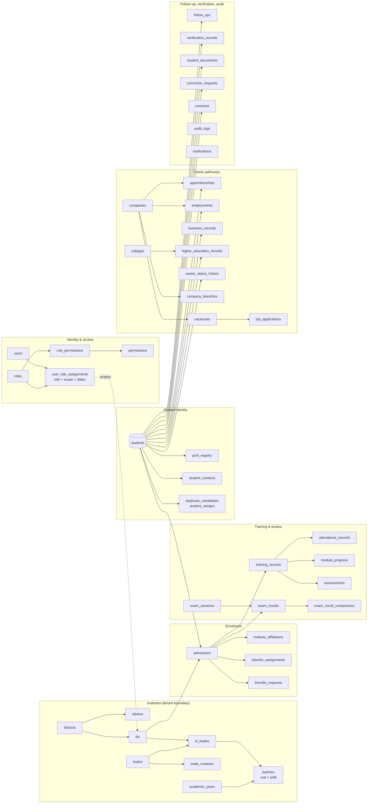
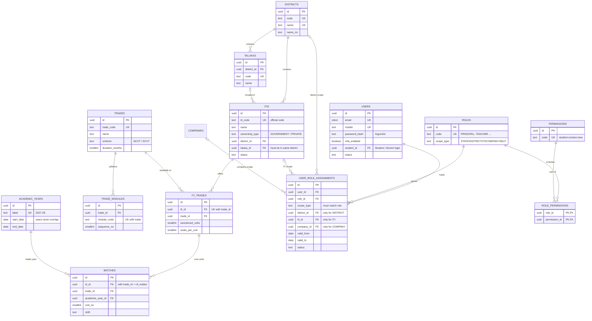
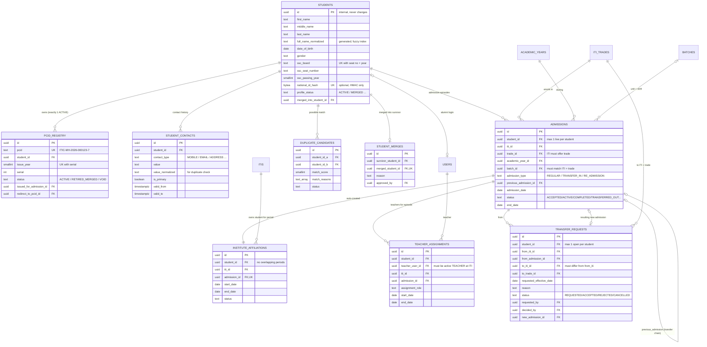
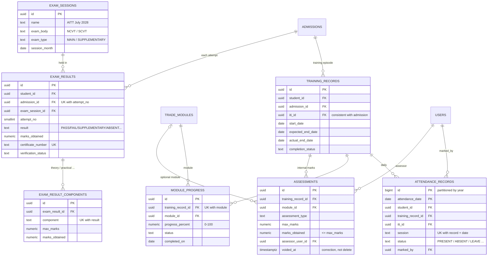
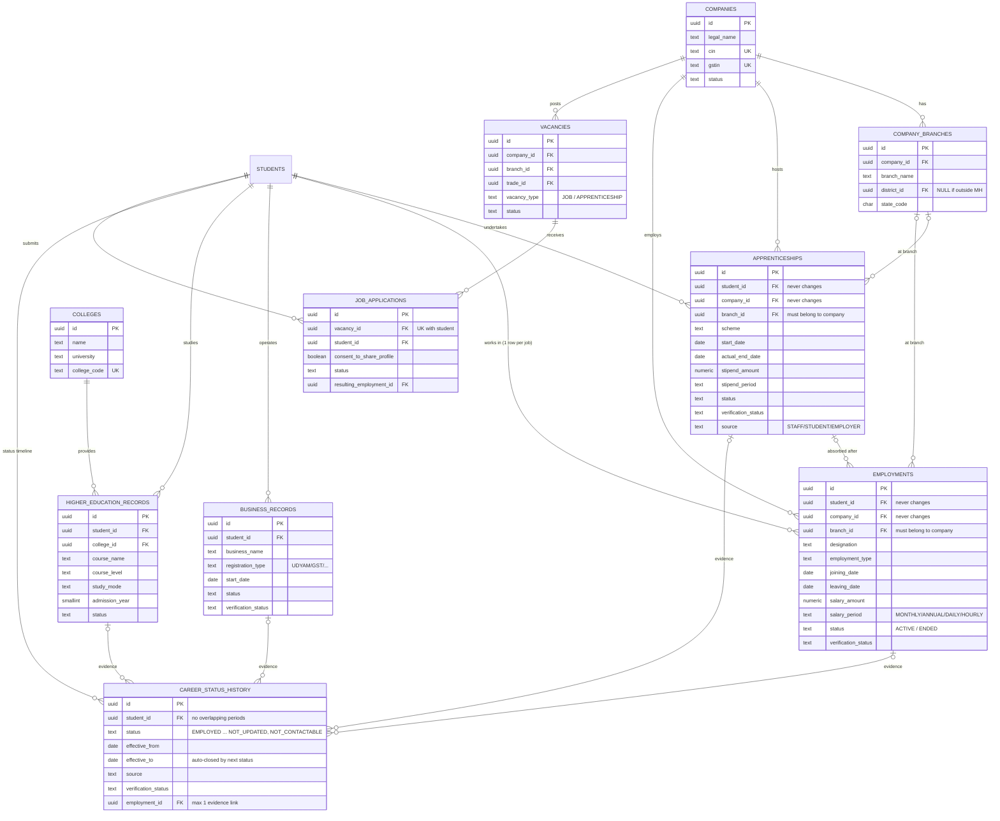
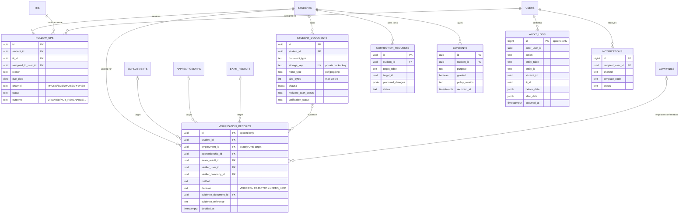

# ITI CareerTrack — Database ER Diagram (v1.0 review draft)

> **How to read the diagrams**
> - Each box is a table. `PK` = primary key (the row's own ID), `FK` = foreign key (a link to another table), `UK` = must be unique.
> - Line endings: `||` = exactly one, `o|` = zero or one, `o{` = zero or many, `|{` = one or many.
>   Example: `STUDENTS ||--o{ EMPLOYMENTS` reads *"one student has zero or many employment records"*.
> - The full model has **48 tables** (attendance is additionally split into yearly partitions). To keep it readable it is shown as one **domain map** plus **five detailed diagrams**.
> - PNG copies of every diagram are in [`diagrams/`](diagrams/).
> - The exact column list, data types and constraints are in [`../database/schema.sql`](../database/schema.sql).

---

## 0. Domain map (the big picture)

---

## 1. Institutes, trades and access control

---

## 2. Student identity, PCID and enrolment

---

## 3. Training, attendance, assessments and examinations

---

## 4. Career pathways, employers and colleges

---

## 5. Follow-up, verification, documents, consent and audit

> Not drawn to save space: `integration_logs` (technical log of external calls, no personal data), `pcid_year_counters` (one row per year holding the last PCID serial).
