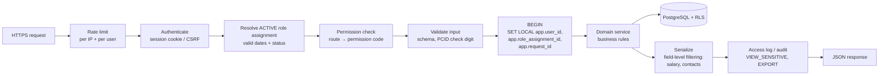

# ITI CareerTrack — API Architecture (v1.0 review draft)

> Design only. Endpoints, rules and examples to review before implementation.

## 1. Principles

1. **REST + JSON**, versioned under `/api/v1`, described with an **OpenAPI 3.1** contract that is generated and checked in CI.
2. **Default deny.** Every route declares the permission it needs. A route without a declaration is rejected at build time.
3. **The server decides scope.** `iti_id`, `district_id`, `company_id`, `student_id` (for students) and role always come from the **active role assignment** in the session, never from the browser. Path or body IDs are only *requests*, which are then checked.
4. **Two-layer enforcement:** the API checks permissions, and PostgreSQL Row-Level Security filters every query (see `schema.sql` §15 and §19).
5. **Transactions for multi-step work** (admission + PCID, transfer acceptance, merges), mostly as database functions.
6. **History is never overwritten.** There are no `DELETE` endpoints for lifecycle data. Corrections use `POST .../void` (with a reason) or correction requests.

## 2. Request pipeline



## 3. Authentication & sessions

| Topic | Design |
|---|---|
| Login | `POST /auth/login` with e-mail or mobile + password. Passwords hashed with **Argon2id**. |
| MFA | TOTP authenticator app; **mandatory** for State Admin, District Admin and Principal; optional for others |
| Students / alumni | Mobile OTP login (provider TBC) + optional password |
| Session | Server-side session, **http-only, Secure, SameSite=Lax cookie**; 30-minute idle timeout, 12-hour absolute timeout; CSRF token for state-changing requests |
| Role switching | `GET /me/role-assignments` → `POST /auth/active-role {role_assignment_id}`; the new role is stored in the session and audited |
| Lockout | Progressive delay; account locked after 10 failures; State Admin can unlock |
| Password reset | One-time, 15-minute token; all sessions revoked after a reset |

## 4. Conventions

| Topic | Rule |
|---|---|
| IDs | UUIDs in paths. PCID lookups use `/students/by-pcid/{pcid}` (format + check digit validated first). |
| Dates | `YYYY-MM-DD`; timestamps ISO-8601 UTC; UI shows Asia/Kolkata time |
| Money | `{ "amount": "15000.00", "period": "MONTHLY", "currency": "INR" }` (decimal string, never float) |
| Pagination | Cursor based: `?limit=50&cursor=…` → `{ data: [...], next_cursor: "…" }` (max 200) |
| Filtering | Explicit query params, e.g. `?academic_year=2026-27&trade_id=…&status=ACTIVE&verification=PENDING` |
| Sorting | `?sort=-admission_date,last_name` (allow-listed fields only) |
| Concurrency | Responses include `ETag: "<version>"`; updates require `If-Match`, otherwise **412 Precondition Failed** |
| Idempotency | All `POST` create calls accept an `Idempotency-Key` header; repeats within 24 h return the original result |
| Errors | RFC 9457 `application/problem+json` (below) |
| Language | Field labels and messages via i18n keys (English + Marathi in the UI) |

**Error format:**
```json
{
  "type": "https://careertrack.example/errors/duplicate-student",
  "title": "Possible duplicate student",
  "status": 409,
  "code": "STUDENT_POSSIBLE_DUPLICATE",
  "detail": "A student with a very similar name and the same date of birth already exists.",
  "request_id": "req_01HF…",
  "candidates": [ { "pcid": "ITIC-MH-2026-000123-7", "name": "R***** P****", "birth_year": 2009, "score": 85, "reasons": ["FIRST_NAME","SURNAME","DATE_OF_BIRTH"] } ]
}
```
Status codes: `400` validation · `401` not logged in · `403` logged in but not allowed · `404` not found **or not visible** (we never reveal that a record exists in another ITI) · `409` business conflict · `412` stale version · `422` rule violation · `429` rate limit.

## 5. Endpoint catalogue

Legend: **Perm** = required permission code (see `schema.sql` §20).

### 5.1 Auth & self
| Method | Path | Perm | Notes |
|---|---|---|---|
| POST | `/auth/login` | public | rate-limited |
| POST | `/auth/mfa/verify` | session (pending) | |
| POST | `/auth/logout` | session | |
| POST | `/auth/active-role` | session | choose role assignment |
| GET | `/me` | session | user + active role + permissions (UI uses this to build menus) |
| GET | `/me/role-assignments` | session | |

### 5.2 Master data
| Method | Path | Perm |
|---|---|---|
| GET | `/districts`, `/districts/{id}/talukas` | any authenticated |
| GET / POST / PATCH | `/itis`, `/itis/{id}` | read: authenticated · write: `master_data.manage` |
| GET / POST | `/itis/{id}/trades` | read: authenticated · write: `master_data.manage` |
| GET / POST / PATCH | `/trades`, `/trades/{id}/modules` | `master_data.manage` for write |
| GET / POST | `/academic-years` | `master_data.manage` for write |
| GET / POST | `/itis/{id}/batches` | `admission.manage` (own ITI) |

### 5.3 Users & roles
| Method | Path | Perm | Notes |
|---|---|---|---|
| GET / POST | `/users` | `user.manage` | Principal: only staff of own ITI |
| POST | `/users/{id}/role-assignments` | `user.manage` | Principal may grant only TEACHER / PLACEMENT_OFFICER / ITI_STAFF at own ITI (also enforced by RLS) |
| POST | `/role-assignments/{id}/revoke` | `user.manage` | |

### 5.4 Students & PCID
| Method | Path | Perm | Notes |
|---|---|---|---|
| POST | `/students/duplicate-check` | `student.create` | returns masked candidates + score |
| GET | `/students` | `student.view` | scoped list; filters: year, trade, unit, shift, status, pathway, verification |
| GET | `/students/{id}` | `student.view` | full or summary depending on access level |
| GET | `/students/by-pcid/{pcid}` | `student.view` | 404 if not visible |
| PATCH | `/students/{id}` | `student.update` | non-verified fields only; others via correction |
| GET / POST | `/students/{id}/contacts` | `student.contact.view` / `student.update` | new value closes the old one |
| GET | `/students/{id}/career-timeline` | `student.view` | the "Career Passport" |
| GET | `/students/{id}/audit` | `audit.view` | |
| GET | `/duplicates` | `student.create` | review queue |
| POST | `/duplicates/{id}/resolve` | State Admin | `NOT_DUPLICATE` or merge |

### 5.5 Admissions, assignments, transfers
| Method | Path | Perm | Notes |
|---|---|---|---|
| POST | `/admissions` | `student.create` + `admission.manage` | creates or links a student, issues PCID, in one transaction (example below) |
| GET | `/students/{id}/admissions` | `student.view` | |
| POST | `/admissions/{id}/status` | `admission.manage` | ACTIVE / COMPLETED / DISCONTINUED (+ date, reason) |
| POST | `/teacher-assignments` | `teacher_assignment.manage` | single student, or `batch_id` for bulk |
| POST | `/teacher-assignments/{id}/end` | `teacher_assignment.manage` | sets end_date, never deletes |
| GET | `/teachers/me/students?scope=current\|previous` | `student.view` | current = full, previous = summary |
| POST | `/transfers` | `transfer.request` | origin ITI only |
| GET | `/transfers?direction=inbound\|outbound&status=` | `transfer.request` / `transfer.approve` | |
| POST | `/transfers/{id}/accept` | `transfer.approve` | destination only → `app.accept_transfer()` |
| POST | `/transfers/{id}/reject` | `transfer.approve` | reason required |
| POST | `/transfers/{id}/cancel` | `transfer.request` | origin only, while REQUESTED |

### 5.6 Training & exams
| Method | Path | Perm |
|---|---|---|
| POST | `/training-records` | `admission.manage` |
| POST | `/attendance/bulk` (one batch, one date) | `attendance.mark` |
| GET | `/students/{id}/attendance?from=&to=` | `student.view` |
| PUT | `/training-records/{id}/modules/{module_id}` | `training.update` |
| POST | `/assessments`, `/assessments/{id}/void` | `assessment.record` |
| GET / POST | `/exam-sessions` | `master_data.manage` |
| POST | `/exam-results` (each attempt = new) | `exam_result.record` |
| GET | `/students/{id}/results` | `student.view` |

### 5.7 Career pathways
| Method | Path | Perm | Notes |
|---|---|---|---|
| POST | `/apprenticeships` | `career.record` | |
| POST | `/apprenticeships/{id}/complete` | `career.record` | |
| POST | `/employments` | `career.record` | **a job change = a new POST**, never a PATCH of the employer |
| POST | `/employments/{id}/end` | `career.record` | leaving date + reason |
| POST | `/business-records` | `career.record` | |
| POST | `/higher-education-records` | `career.record` | |
| POST | `/career-status` | `career.record` | closes the previous status automatically |
| POST | `/{collection}/{id}/void` | `career.record` | reason required; record kept |
| POST | `/correction-requests`, `/correction-requests/{id}/decide` | `self.update` / `verification.decide` | |

### 5.8 Employers, vacancies, applications
| Method | Path | Perm |
|---|---|---|
| GET / POST / PATCH | `/companies`, `/companies/{id}/branches` | `vacancy.manage` (own company) / staff |
| GET / POST / PATCH | `/vacancies` | `vacancy.manage` |
| POST | `/vacancies/{id}/applications` | `self.update` (student) or `application.manage` (referral) — consent required |
| PATCH | `/applications/{id}` | `application.manage` |
| GET | `/employer/engagements` | `employer.confirm` |
| POST | `/employer/engagements/{type}/{id}/confirm` | `employer.confirm` — writes `verification_records` |

### 5.9 Follow-ups, verification, documents, notifications
| Method | Path | Perm |
|---|---|---|
| GET | `/follow-ups?status=pending&assigned_to=me&due_before=` | `followup.work` / `followup.manage` |
| POST | `/follow-ups`, `/follow-ups/bulk` | `followup.manage` |
| POST | `/follow-ups/{id}/outcome` | `followup.work` |
| POST | `/verification-records` | `verification.decide` |
| POST | `/students/{id}/documents/upload-url` | `student.update` / `self.update` |
| POST | `/documents/{id}/complete` | (same) → malware scan job |
| GET | `/documents/{id}/download-url` | `student.document.view` → 5-minute signed link, audited |

### 5.10 Reports & audit
| Method | Path | Perm |
|---|---|---|
| GET | `/reports/iti/{iti_id}/outcomes?cohort=2026-27&denominator=completed` | `report.iti` |
| GET | `/reports/district/{id}/outcomes` | `report.district` |
| GET | `/reports/state/outcomes` | `report.state` |
| POST | `/exports` → `GET /exports/{id}` | report perm; background job, private link |
| GET | `/audit-logs?student_id=&from=&to=` | `audit.view` |

Every report response includes `generated_at`, `data_as_of`, `filters`, `denominator`, `unique_students`, `pathway_events` and a breakdown by `verification_status`, including `NOT_UPDATED`.

## 6. Key flow examples

### 6.1 New admission (creates student + PCID)
```http
POST /api/v1/admissions
Idempotency-Key: 6c1e…
{
  "student": {
    "first_name": "…", "middle_name": "…", "last_name": "…",
    "date_of_birth": "2009-05-14", "gender": "MALE",
    "ssc": { "board": "MSBSHSE", "seat_number": "…", "passing_year": 2025 },
    "contacts": [ { "type": "MOBILE", "value": "98765…", "primary": true } ]
  },
  "trade_id": "…", "academic_year_id": "…", "batch_id": "…",
  "admission_date": "2026-08-01",
  "duplicate_override": null
}
```
*Note: there is **no** `iti_id` in the body. It is taken from the Principal's active role.*
- Score ≥ 70 → `409 STUDENT_POSSIBLE_DUPLICATE` with masked candidates. The user either sends `existing_student_id` instead of `student`, or repeats the request with `"duplicate_override": {"reason": "…"}` (≥ 70 and < 100 only; audited).
- Success → `201` `{ "student_id": "…", "admission_id": "…", "pcid": "ITIC-MH-2026-000123-7" }`.

### 6.2 Transfer
`POST /transfers {student_id, to_iti_id, to_trade_id, to_academic_year_id, effective_date, reason}` → `201 REQUESTED`.
Destination: `POST /transfers/{id}/accept {batch_id?, remarks?}` → `200 { new_admission_id, pcid }` (PCID unchanged).

### 6.3 Career timeline
```json
GET /api/v1/students/{id}/career-timeline
{ "pcid": "ITIC-MH-2026-000123-7",
  "current_status": { "status": "EMPLOYED", "since": "2029-08-01", "verification": "VERIFIED" },
  "events": [
    { "date": "2026-08-01", "type": "ADMISSION",   "iti": "…", "summary": "REGULAR / TRANSFERRED_OUT" },
    { "date": "2026-10-31", "type": "TRANSFER",    "summary": "ITI A → ITI B" },
    { "date": "2028-08-20", "type": "EXAM_RESULT", "summary": "Attempt 1: FAIL" },
    { "date": "2029-08-01", "type": "EMPLOYMENT",  "summary": "Electrician", "verification": "VERIFIED",
      "salary": { "amount": "19000.00", "period": "MONTHLY" } } ] }
```
`salary` is omitted for roles without `career.salary.view`.

## 7. Files & documents
1. The client asks for an upload URL. The API creates a `student_documents` row (`malware_scan_status = PENDING`) and returns a **pre-signed upload URL** to a **private** bucket (max 10 MB; PDF, JPEG or PNG only).
2. The client uploads directly to storage and then calls `/complete`. A background job checks type, size and SHA-256 and scans for malware.
3. Downloads go through `/download-url`: a permission check, then a 5-minute signed link, and an audit entry. Files are never given public URLs.

## 8. Background jobs
| Job | Schedule |
|---|---|
| Create follow-ups for students with no update for N months (status stays as it is, never set to "unemployed") | nightly |
| Reminder notifications (SMS / WhatsApp / e-mail, respecting consent) | queue |
| Refresh report summaries (materialised views on a read replica) | nightly + on demand |
| Exports | on demand |
| Create next year's attendance partition | yearly |
| Backup verification (restore into a test environment) | weekly |

## 9. Code structure (modular monolith)
```
api/
  src/
    platform/   auth, sessions, rbac (permission guard), db (transaction + RLS context), audit, errors, i18n
    modules/
      institutes/   students/   admissions/   transfers/   training/   exams/
      careers/      employers/  followups/    verification/  documents/  reports/
    jobs/       notification worker, scheduled tasks
  migrations/   numbered SQL migrations (from database/schema.sql)
  tests/        unit · API integration · cross-tenant security · acceptance (section 15)
```
Each module owns its routes, services and SQL. Modules talk to each other only through service interfaces, never by reaching into another module's tables, so a module can later be split out if needed.
